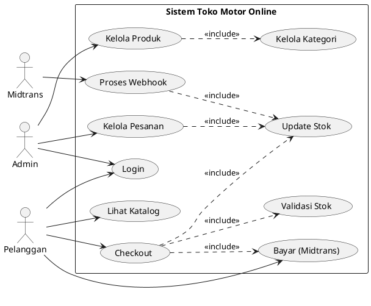

# Panduan Membuat Use Case Diagram

---

## 1. Apa itu Use Case Diagram?

Use Case Diagram adalah diagram UML (Unified Modeling Language) yang menggambarkan **interaksi antara aktor (pengguna/sistem eksternal) dengan sistem** yang sedang dikembangkan. Diagram ini menunjukkan **apa yang dilakukan sistem** dari sudut pandang pengguna, bukan bagaimana sistem bekerja secara internal.

### Tujuan Use Case Diagram:
- Mengidentifikasi aktor yang berinteraksi dengan sistem
- Mendokumentasikan fungsi/layanan utama sistem
- Menjadi dasar pengembangan dokumen spesifikasi kebutuhan (SRS)
- Memudahkan komunikasi antara pengembang dan stakeholder

---

## 2. Komponen Utama Use Case Diagram

### 2.1 Aktor (Actor)

Aktor adalah entitas eksternal yang berinteraksi dengan sistem. Aktor bisa berupa:
- **Manusia** (admin, pelanggan, karyawan)
- **Sistem eksternal** (payment gateway, email service, API)
- **Perangkat** (sensor, mesin)

**Simbol:**

```
    O       ← lingkaran (kepala)
   /|\      ← garis (tubuh)
   / \      ← garis (kaki)

Contoh:
         O
        /|\
   Admin / \
```

**Jenis Aktor:**
| Jenis | Deskripsi | Contoh |
|-------|-----------|--------|
| Primary Actor | Aktor yang memulai interaksi | Pelanggan, Admin |
| Secondary Actor | Aktor yang merespons/ dipanggil sistem | Payment Gateway, Email Service |

### 2.2 Use Case

Use Case adalah fungsi atau layanan yang disediakan oleh sistem. Setiap use case mewakili satu unit fungsionalitas.

**Simbol:** Oval/Elips dengan nama use case di dalamnya

```
   ╭─────────────────────╮
   │   Login ke Sistem    │
   ╰─────────────────────╯
```

**Tips Penamaan Use Case:**
- Gunakan **verba + objek** (contoh: "Kelola Produk", "Lihat Dashboard")
- Gunakan **kata kerja aktif** (bukan pasif)
- **Spesifik**, hindari nama yang terlalu umum
- Konsisten dengan istilah yang dipahami stakeholder

### 2.3 Sistem (Boundary)

Perbatasan sistem menunjukkan lingkup sistem yang sedang didesain. Semua use case berada **di dalam** boundary.

**Simbol:** Persegi panjang besar yang membungkus semua use case

```
╔═══════════════════════════════════════════╗
║            SISTEM TOKO ONLINE             ║
║                                           ║
║   ╭─────────────────────╮                 ║
║   │   Login ke Sistem    │                 ║
║   ╰─────────────────────╯                 ║
║                                           ║
║   ╭─────────────────────╮                 ║
║   │   Lihat Produk       │                 ║
║   ╰─────────────────────╯                 ║
║                                           ║
╚═══════════════════════════════════════════╝
```

### 2.4 Relasi/Asosiasi

Hubungan antara aktor dan use case, atau antar use case.

**Simbol:** Garis lurus

```
        O
       /|\
  Aktor   ╭─────────────────╮
          │   Login Sistem   │
          ╰─────────────────╯
              ← garis asosiasi
```

---

## 3. Jenis Relasi Antar Use Case

### 3.1 Include (Bawaan/Wajib)

Relasi **include** berarti use case **selalu memanggil** use case lainnya. Use case yang di-include bersifat **wajib** dan tidak bisa dilewati.

**Notasi:** `<<include>>` pada garis putus-putus dengan panah ke use case yang dipanggil

```
╭─────────────────────╮      <<include>>      ╭─────────────────────╮
│     Checkout         │ ─ ─ ─ ─ ─ ─ ─ ─ ─ ▶ │  Validasi Stok      │
╰─────────────────────╯                       ╰─────────────────────╯
```

**Kapan menggunakan Include:**
- Saat use case **selalu** membutuhkan fungsi lain
- Untuk menghindari duplikasi deskripsi
- Contoh: Checkout **selalu** memvalidasi stok

### 3.2 Extend (Opsional/Kondisional)

Relasi **extend** berarti use case lain **bisa memanggil** use case ini, tapi **tidak wajib**. Hanya terjadi dalam kondisi tertentu.

**Notasi:** `<<extend>>` pada garis putus-putus dengan panah ke use case yang memperluas

```
╭─────────────────────╮      <<extend>>      ╭─────────────────────╮
│  Validasi Stok       │ ─ ─ ─ ─ ─ ─ ─ ─ ─ ▶ │  Tampilkan Alert    │
╰─────────────────────╯                       ╰─────────────────────╯
```

**Kapan menggunakan Extend:**
- Saat use case **opsional** atau hanya terjadi dalam kondisi tertentu
- Contoh: Menampilkan alert error hanya jika stok habis

### 3.3 Generalization (Pewarisan)

Generalization berarti **use case anak** mewarisi semua perilaku **use case induk**, dengan tambahan perilaku spesifik.

**Notasi:** Garis putus-putus dengan segitiga kosong

```
╭─────────────────────╮
│     Bayar           │
╰──────────┬──────────╯
           │
     ╱     ╲      ← segitiga (generalization)
    ╱       ╲
╭─────────────────────╮   ╭─────────────────────╮
│   Bayar Tunai       │   │   Bayar Online      │
╰─────────────────────╯   ╰─────────────────────╯
```

---

## 4. Langkah-Langkah Membuat Use Case Diagram

### Langkah 1: Identifikasi Aktor

**Pertanyaan untuk mengidentifikasi aktor:**
1. Siapa yang menggunakan sistem ini?
2. Siapa yang memasukkan data ke sistem?
3. Siapa yang menerima informasi dari sistem?
4. Sistem eksternal apa yang berinteraksi dengan sistem?
5. Siapa yang melakukan pengawasan/monitoring?

**Contoh Identifikasi Aktor:**
```
┌──────────────────────────────────────────┐
│              DAFTAR AKTOR                │
├──────────────────────────────────────────┤
│ 1. Admin        → Mengelola data toko    │
│ 2. Pelanggan    → Berbelanja produk      │
│ 3. Sistem       → Proses otomatis        │
│ 4. Midtrans     → Payment gateway        │
└──────────────────────────────────────────┘
```

### Langkah 2: Identifikasi Use Case

**Pertanyaan untuk mengidentifikasi use case:**
1. Apa yang ingin dilakukan aktor dengan sistem?
2. Apa fungsi utama yang harus disediakan sistem?
3. Apa informasi yang perlu dihasilkan sistem?
4. Apa yang terjadi jika terjadi error/kondisi khusus?

**Contoh Identifikasi Use Case:**
```
┌─────────────────────────────────────────────────────────────┐
│                    DAFTAR USE CASE                          │
├─────────────────────────────────────────────────────────────┤
│                                                             │
│  ADMIN:                    │  PELANGGAN:                    │
│  ├ UC-01: Login            │  ├ UC-10: Registrasi Akun      │
│  ├ UC-02: Lihat Dashboard  │  ├ UC-11: Lihat Katalog        │
│  ├ UC-03: Kelola Kategori  │  ├ UC-12: Cari Produk          │
│  ├ UC-04: Kelola Produk    │  ├ UC-13: Lihat Detail Produk  │
│  ├ UC-05: Catat Stok Masuk │  ├ UC-14: Kelola Keranjang     │
│  ├ UC-06: Catat Stok Keluar│  ├ UC-15: Checkout             │
│  ├ UC-07: Riwayat Stok     │  ├ UC-16: Bayar (Midtrans)     │
│  ├ UC-08: Kelola Pesanan   │  ├ UC-17: Upload Bukti Bayar   │
│  ├ UC-09: Kelola Pembayaran│  ├ UC-18: Riwayat Pesanan      │
│  ├ UC-20: Laporan Stok     │  ├ UC-19: Detail Pesanan       │
│  ├ UC-22: Laporan Penjualan│  ├ UC-21: Batalkan Pesanan     │
│  ├ UC-24: Lihat Statistik  │  ├ UC-23: Kelola Alamat        │
│  └ UC-25: Logout           │  ├ UC-26: Ubah Profil          │
│                             │  └ UC-27: Logout               │
│  SISTEM:                    │  MIDTRANS:                     │
│  ├ UC-28: Webhook Midtrans  │  ├ UC-32: Proses Pembayaran    │
│  ├ UC-29: Validasi Stok     │  └ UC-33: Kirim Webhook        │
│  ├ UC-30: Gen Nomor Pesanan │                                │
│  └ UC-31: Update Stok       │                                │
└─────────────────────────────────────────────────────────────┘
```

### Langkah 3: Tentukan Relasi Antara Use Case

Tentukan hubungan antar use case:

```
Relasi Include (Wajib):
─────────────────────────────────────────────
UC-04 (Kelola Produk)    → <<include>> → UC-03 (Kelola Kategori)
UC-05 (Stok Masuk)       → <<include>> → UC-31 (Update Stok)
UC-06 (Stok Keluar)      → <<include>> → UC-31 (Update Stok)
UC-08 (Kelola Pesanan)   → <<include>> → UC-31 (Update Stok)
UC-15 (Checkout)         → <<include>> → UC-29 (Validasi Stok)
UC-15 (Checkout)         → <<include>> → UC-30 (Gen No. Pesanan)
UC-15 (Checkout)         → <<include>> → UC-31 (Update Stok)
UC-21 (Batal Pesanan)    → <<include>> → UC-31 (Update Stok)

Relasi Extend (Opsional):
─────────────────────────────────────────────
UC-14 (Keranjang)        → <<extend>>  → UC-29 (Validasi Stok)
  (hanya saat stok tidak cukup)
```

### Langkah 4: Gambar Use Case Diagram

Gunakan prinsip layout berikut:

```
┌────────────────────────────────────────────────────────────────────────────┐
│                        LAYOUT USE CASE DIAGRAM                            │
├────────────────────────────────────────────────────────────────────────────┤
│                                                                            │
│   ┌──────┐                                        ┌──────┐                │
│   │Admin │                                        │User  │                │
│   └──┬───┘                                        └──┬───┘                │
│      │                                                │                    │
│      │  ╔═══════════════════════════════════════════════════╗              │
│      │  ║           NAMA SISTEM / NAMA PROYEK               ║              │
│      │  ║                                                   ║              │
│      ▼  ║  ┌─────────────────────┐  ┌────────────────────┐  ║              │
│     ──▶ ║  │    Use Case 1       │  │    Use Case 2      │  ║              │
│         ║  └─────────────────────┘  └────────────────────┘  ║              │
│         ║          │                    │                    ║              │
│         ║          └────────────────────┘                    ║              │
│         ║                  <<include>>                       ║              │
│         ║          ┌────────────────────┐                    ║              │
│         ║          │    Use Case 3      │                    ║              │
│         ║          └────────────────────┘                    ║              │
│         ║                                                   ║              │
│         ╚═══════════════════════════════════════════════════╝              │
│                                                                            │
│   ┌──────┐                                                                │
│   │Ext.  │                                                                │
│   │System│                                                                │
│   └──────┘                                                                │
│                                                                            │
└────────────────────────────────────────────────────────────────────────────┘
```

**Tips Layout:**
1. **Aktor utama di kiri**, actor pendukung di kanan
2. **Gunakan boundary** untuk membatasi sistem
3. **Use case terkait didekatkan** satu sama lain
4. **Hindari garis saling silang** sebisa mungkin
5. **Gunakan warna berbeda** untuk aktor berbeda (opsional)

---

## 5. Contoh Implementasi

### 5.1 Use Case Diagram Sederhana - Sistem Login

```
         O                               O
        /|\                             /|\
    Admin / \                       Pelanggan / \
         │                               │
         │  ╔═══════════════════════════╗ │
         │  ║    SISTEM TOKO ONLINE      ║ │
         ▼  ║                           ║ ▼
    ──────▶ ║  ╭─────────────────────╮  ║ ──────▶
            ║  │   Login Sistem      │  ║
            ║  ╰──────────┬──────────╯  ║
            ║             │ <<include>>  ║
            ║             ▼              ║
            ║  ╭─────────────────────╮  ║
            ║  │  Validasi Kredensial │  ║
            ║  ╰─────────────────────╯  ║
            ║                           ║
            ║  ╭─────────────────────╮  ║
            ║  │  Lihat Dashboard    │  ║
            ║  ╰─────────────────────╯  ║
            ║                           ║
            ╚═══════════════════════════╝
```

### 5.2 Use Case Diagram dengan Include & Extend

```
         O                               O
        /|\                             /|\
    Admin / \                       Pelanggan / \
         │                               │
         │  ╔═══════════════════════════╗ │
         │  ║    SISTEM TOKO ONLINE      ║ │
         ▼  ║                           ║ ▼
    ──────▶ ║  ╭─────────────────────╮  ║ ──────▶
            ║  │  Kelola Produk       │  ║
            ║  ╰──────────┬──────────╯  ║
            ║             │ <<include>>  ║
            ║             ▼              ║
            ║  ╭─────────────────────╮  ║
            ║  │  Kelola Kategori     │  ║
            ║  ╰─────────────────────╯  ║
            ║                           ║
            ║  ╭─────────────────────╮  ║
            ║  │     Checkout        │  ║
            ║  ╰──────────┬──────────╯  ║
            ║             │ <<include>>  ║
            ║             ▼              ║
            ║  ╭─────────────────────╮  ║
            ║  │  Validasi Stok      │◀─║─ ─ ─ ─ <<extend>>
            ║  ╰──────────┬──────────╯  ║        (hanya jika stok habis)
            ║             │ <<include>>  ║
            ║             ▼              ║
            ║  ╭─────────────────────╮  ║
            ║  │  Update Stok        │  ║
            ║  ╰─────────────────────╯  ║
            ║                           ║
            ╚═══════════════════════════╝
```

---

## 6. Tools untuk Membuat Use Case Diagram

| Tool | Platform | Keterangan |
|------|----------|------------|
| **Draw.io (diagrams.net)** | Web/ Desktop | Gratis, mudah digunakan |
| **Lucidchart** | Web | Kolaborasi real-time, berbayar |
| **PlantUML** | Web/ Desktop | Code-based, bagus untuk dokumentasi |
| **StarUML** | Desktop | Profesional, berbayar |
| **Microsoft Visio** | Desktop | Standar industri, berbayar |
| **Figma** | Web | Gratis untuk personal, desain fleksibel |

### Contoh Kode PlantUML:



---

## 7. Best Practices / Tips Terbaik

### ✅ Yang Harus Dilakukan:
1. **Gunakan nama aktor yang jelas** - sesuai peran, bukan nama orang
2. **Gunakan verba + objek untuk nama use case** - "Kelola Produk", bukan "Produk"
3. **Gunakan include untuk dependensi wajib** - hindari duplikasi
4. **Gunakan extend untuk dependensi opsional** - hanya kondisi tertentu
5. **Jaga diagram tetap sederhana** - maksimal 7-10 use case per diagram
6. **Gunakan boundary untuk membatasi sistem**
7. **Buat dokumentasi use case** dalam tabel terpisah

### ❌ Yang Tidak Boleh Dilakukan:
1. **Jangan buat use case terlalu granular** - "Tekan Tombol Login" bukan use case
2. **Jangan mencampur level abstraksi** - jangan campur "Login" dengan "Buka Halaman"
3. **Jangan membuat diagram terlalu rumit** - split menjadi beberapa diagram jika perlu
4. **Jangan gunakan use case untuk data flow** - use case untuk interaksi, bukan data
5. **Jangan mengabaikan aktor non-manusia** - sistem eksternal juga aktor

---

## 8. Template Dokumentasi Use Case

Gunakan tabel berikut untuk mendokumentasikan setiap use case:

```
┌─────────────────────────────────────────────────────────────┐
│                    DETAIL USE CASE                          │
├─────────────────────────────────────────────────────────────┤
│  Kode           : UC-XX                                    │
│  Nama Use Case  : [Nama Use Case]                          │
│  Aktor          : [Aktor yang terlibat]                     │
│  Deskripsi      : [Penjelasan singkat use case]            │
│  precondition   : [Kondisi sebelum use case dieksekusi]    │
│  postcondition  : [Kondisi setelah use case selesai]       │
│  Main Flow      : [Langkah-langkah utama]                  │
│  Alternative Flow: [Langkah alternatif/error]              │
│  Include        : [Use case yang dipanggil wajib]          │
│  Extend         : [Use case yang bisa memperluas]          │
└─────────────────────────────────────────────────────────────┘
```

**Contoh Isian:**

| Field | Isian |
|-------|-------|
| Kode | UC-15 |
| Nama Use Case | Checkout |
| Aktor | Pelanggan |
| Deskripsi | Pelanggan memproses pesanan dari keranjang belanja |
| Precondition | Pelanggan sudah login, keranjang tidak kosong |
| Postcondition | Pesanan dibuat, stok dikurangi, nomor pesanan di-generate |
| Main Flow | 1. Pelanggan klik Checkout → 2. Pilih alamat → 3. Pilih metode bayar → 4. Konfirmasi → 5. Sistem validasi stok → 6. Generate nomor pesanan → 7. Kurangi stok → 8. Tampilkan halaman bayar |
| Alternative Flow | Jika stok habis → tampilkan pesan error, kembali ke keranjang |
| Include | UC-29 (Validasi Stok), UC-30 (Gen No. Pesanan), UC-31 (Update Stok) |
| Extend | — |

---

## 9. Kesimpulan

| Aspek | Penjelasan |
|-------|------------|
| **Apa** | Diagram yang menggambarkan interaksi aktor-sistem |
| **Mengapa** | Untuk memahami kebutuhan fungsi sistem |
| **Kapan** | Di awal proyek (fase analisis kebutuhan) |
| **Siapa** | Analyst, Designer, Developer, Stakeholder |
| **Bagaimana** | Identifikasi actor → Use case → Relasi → Gambar |

---

*Dokumen panduan ini untuk pembuatan Use Case Diagram Sistem Informasi Toko Motor Online*
