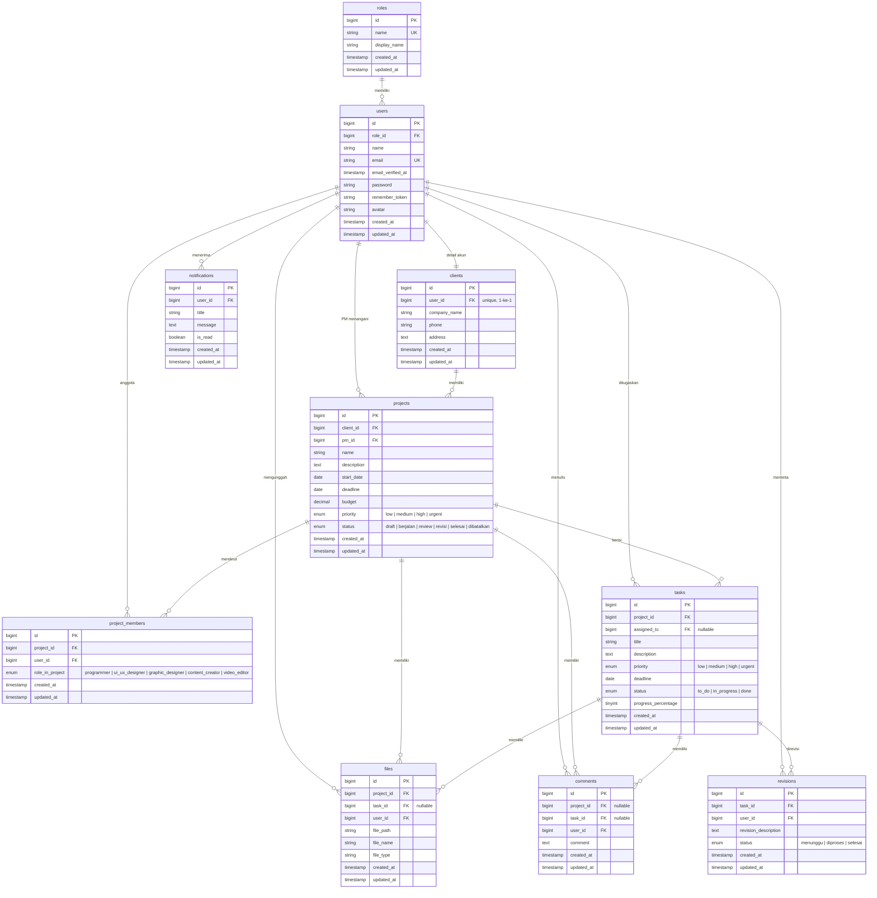

# ERD — Digital Project Management System (DPMS)

Diagram ini dibuat dengan sintaks [Mermaid](https://mermaid.js.org/syntax/entityRelationshipDiagram.html).
Untuk render: buka di GitHub, VS Code (ekstensi Mermaid), atau [Mermaid Live Editor](https://mermaid.live).

